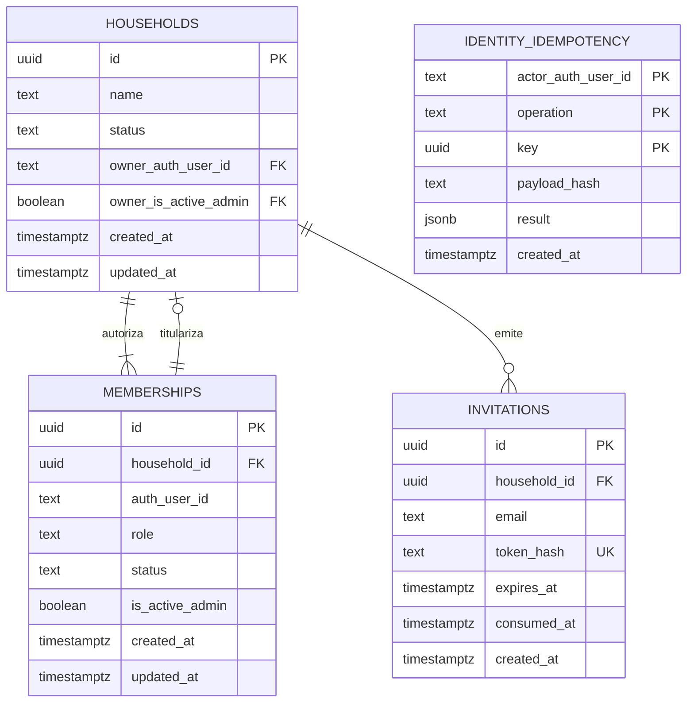

# Diagrama do banco de dados

O diagrama representa as tabelas da migration `001_identity.sql` verificadas em PostgreSQL 18. Consulte o [dicionário de dados](data-dictionary.md) para tipos, índices e restrições.

`households.id` participa também da FK composta do titular. A FK assegura que cada família tenha um titular ativo e administrador dentro de seus próprios vínculos. Um vínculo pode titularizar sua própria família. A validação ocorre no fim da transação por padrão, com `NO ACTION` em atualização e exclusão. As FKs de família em `memberships` e `invitations` usam `RESTRICT` em atualização e exclusão.

Os IDs do provedor de identidade são referências lógicas. Uma identidade pode ter vários vínculos históricos, com no máximo um ativo pelo índice parcial de `001a_identity_single_family.sql`. `identity_idempotency` tem chave independente por ator, operação e UUID do cliente, inclusive para comandos que criam uma família. Nenhuma dessas relações exige alterar objetos do provedor de identidade.
